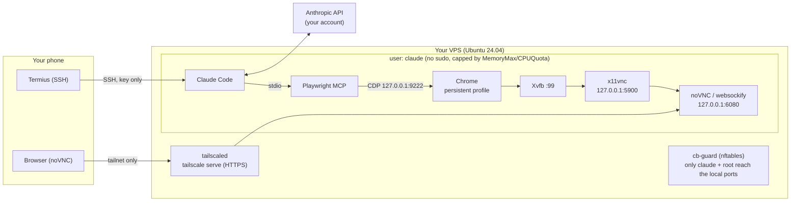

<div align="center">

# claude-cloud-browser

**Your own Claude Code with an always-on browser, in the cloud, driven from your phone.**

One idempotent script turns a small Ubuntu server into a box that runs the official
[Claude Code](https://docs.claude.com/en/docs/claude-code/overview) next to a real, always-on Chrome.
Claude drives that browser through [Playwright MCP](https://github.com/microsoft/playwright-mcp);
you log in to your websites **once, by hand**, through noVNC over Tailscale, and Claude keeps using those sessions.

[](https://github.com/AndreaAcanfora/claude-cloud-browser/actions/workflows/shellcheck.yml)
[](LICENSE)
[](https://www.paypal.com/paypalme/AndreaAca)

</div>

---

## What it does

- **Claude Code, official and unmodified**, installed for a dedicated non-root user. You log in with your own Claude account.
- **A real Chrome that never sleeps.** Headful, inside a virtual display (Xvfb), with a persistent profile: cookies and logins survive restarts and reboots.
- **Claude and you share that browser.** Playwright MCP attaches to it over the Chrome DevTools Protocol (`--cdp-endpoint`), so Claude works in the same tabs and sessions you see.
- **See and touch the browser from your phone** with noVNC, published only on your private Tailscale network. Solve a captcha, approve a 2FA prompt, log in to a site, then hand it back to Claude.
- **Locked down by default:** key-only SSH, ufw, fail2ban, unattended security upgrades, no public port besides SSH, and a resource cap so the browser can never starve the server.
- **Built for flaky phone connections:** every SSH login lands in the same tmux session, so a running Claude survives Termius being suspended and is right there when you reconnect.
- **`cb`**, a small helper: `cb status`, `cb browser`, `cb restart`, `cb logs`.

## Demo

> _Screenshot / GIF placeholder: Termius on the left with Claude Code, noVNC on the right showing the same Chrome._

Typical session from the phone:

```text
$ ssh claude@my-server          # Termius
$ claude
> Open my Hetzner console and tell me which servers are running.
  ● playwright - browser_navigate (https://console.hetzner.cloud)
  ● playwright - browser_snapshot
  You have 2 servers running: ...
```

## How it works



Nothing listens on a public interface except SSH. The DevTools port, VNC and noVNC are bound to `127.0.0.1`,
and an nftables rule rejects local connections to them from any other user on the machine.
noVNC reaches your phone only through `tailscale serve`, inside your own tailnet.

## Quickstart from your phone (Termius, 5 steps)

You need: a fresh **Ubuntu 24.04** server (tested on Hetzner CAX21, 4 vCPU / 8 GB, ARM64; 2 vCPU / 4 GB works for light use),
a [Tailscale](https://tailscale.com) account (free plan is fine) and a Claude subscription.

1. **Create a key in Termius.** Keychain → Generate Key → ED25519. Copy the public key (`ssh-ed25519 AAAA...`).
2. **Create the server** with your Termius key, and paste this as cloud-init "user data" (or run the commands as root over SSH):

   ```bash
   git clone https://github.com/AndreaAcanfora/claude-cloud-browser /opt/claude-cloud-browser
   CB_SSH_PUBKEY='ssh-ed25519 AAAA... termius' bash /opt/claude-cloud-browser/install.sh
   ```

   A ready-made [`cloud-init/user-data.yaml`](cloud-init/user-data.yaml) is included.
3. **Join your tailnet.** Install Tailscale on the phone and log in. On the server, as root:

   ```bash
   tailscale up --hostname=claude-vps
   bash /opt/claude-cloud-browser/install.sh --only tailscale   # publishes noVNC on the tailnet
   ```

4. **Log in to Claude.** In Termius connect as `claude@<server-ip>`, run `claude` and follow the login link
   (it opens fine on the phone). This is your own account, nothing is stored by the installer.
5. **Log in to your sites once.** Run `cb browser`, open the URL it prints on the phone, enter the VNC password it shows,
   and sign in to the websites you want Claude to use. From now on just ask Claude.

## Commands

| Command | What it does |
|---|---|
| `cb status` | Services, DevTools endpoint, Tailscale state, memory used vs cap, Claude Code version |
| `cb browser` | noVNC URL for your phone and the VNC password |
| `cb restart [xvfb\|chrome\|x11vnc\|novnc]` | Restart everything, or one service |
| `cb logs [name] [-f]` | Recent logs, of everything or of one service |
| `Ctrl-b d` | Detach from tmux (Claude keeps running; next login reattaches). `touch ~/.no-tmux` disables auto-attach |
| `sudo bash install.sh --only <step>` | Re-run one step: `system firewall ssh claude shell browser mcp novnc tailscale cb` |

## Configuration

Everything is optional. Set variables in the environment, in `.env` next to `install.sh`,
or in `/etc/claude-cloud-browser/install.env` (handy for cloud-init). See [`.env.example`](.env.example).

| Variable | Default | Meaning |
|---|---|---|
| `CB_USER` | `claude` | Dedicated user that owns Claude Code and the browser |
| `CB_SSH_PUBKEY` | | Public key added to that user |
| `CB_COPY_ROOT_KEYS` | `no` | `yes` copies root's keys to the user (useful with provider-injected keys) |
| `CB_HARDEN_SSH` | `auto` | `auto`/`yes`: key-only SSH once both the user and root have a key. `no`: leave sshd alone |
| `CB_SWAP_GB` | `4` | Minimum total swap |
| `CB_MEMORY_MAX` / `CB_CPU_QUOTA` | `3G` / `200%` | Cap for everything the user runs |
| `CB_TS_HOSTNAME` / `CB_TS_HTTPS_PORT` | `claude-vps` / `443` | Tailscale name and HTTPS port for noVNC |
| `CB_PLAYWRIGHT_VERSION` / `CB_PLAYWRIGHT_MCP_VERSION` | pinned | Browser build (ARM64) and MCP server versions |

## Security

The short version (details in [docs/security.md](docs/security.md)):

- **Only SSH is public**, key-only. Password login is turned off only after the installer has verified a key for both the user and root, so it cannot lock you out.
- **noVNC is never on the internet.** It listens on `127.0.0.1` and is published only inside your tailnet with HTTPS, plus a VNC password.
- **The logged-in browser is the crown jewel.** Anyone who reaches its DevTools port controls your sessions. The port is bound to `127.0.0.1`, an nftables rule rejects other local users, and the X display requires a cookie.
- **Least privilege.** Claude Code and the browser run as a user without sudo, capped by `MemoryMax`/`CPUQuota`. On a server that also hosts other things, that user cannot read root's files.
- **No credentials in this project.** The installer never asks for, stores or sends a password, token or API key. You log in to Claude and Tailscale yourself.
- **Shared server friendly.** If ufw is already active, the installer only adds the SSH rule and never removes existing rules.

> [!IMPORTANT]
> Claude can act in every site you are logged in to in that browser. Log in only where you want Claude to work,
> prefer accounts with limited permissions, and review what it does. Prompt injection from web pages is a real risk.

## Using your own Claude account

Each person runs **their own server** with **their own Claude account**, logged in by themselves, as the
[Claude Code](https://docs.claude.com/en/docs/claude-code/overview) docs describe. This project does not proxy,
share, resell or pool Claude accounts or API keys, and never sees your credentials. Make sure your use complies
with [Anthropic's terms](https://www.anthropic.com/legal) and with the terms of the websites you automate.

## FAQ

**Why not just headless Chrome?**
Many sites behave differently with headless browsers, and you need to see the screen to log in, solve a captcha or approve 2FA. A headful Chrome in Xvfb looks like a normal desktop browser and you can take over at any time.

**Why Chromium on ARM instead of Google Chrome?**
Google does not ship Chrome for Linux on ARM64. On ARM the installer uses the Chromium build distributed by Playwright ("Chrome for Testing"); on x86-64 it installs Google Chrome stable.

**Does the browser update itself?**
Google Chrome (x86-64) updates through apt. The ARM build is pinned: bump `CB_PLAYWRIGHT_VERSION` and re-run `install.sh --only browser` regularly, since this browser holds real sessions.

**Can I run it on a server that already hosts other things?**
Yes, that is how it was first tested. The firewall step is additive, everything runs as a separate capped user, and the local ports are reserved to that user.

**How much does it cost?**
A Hetzner CAX11/CAX21 costs a few euros per month. Claude usage is billed to your own Claude plan.

**Is the VNC password enough?**
It is a second lock. The first one is Tailscale: noVNC is not reachable from outside your tailnet at all.

## Roadmap

**Phase 1 (this repo, today): single user.** One person, one server, installed with one script.

**Phase 2: self-serve, still zero custody.** A small web flow where someone pays (Stripe) and gets their own box,
**without the maintainer ever hosting servers or holding anyone's credentials**:

1. The user pays with Stripe and pastes a short-lived **Hetzner API token from their own Hetzner account**.
2. A provisioning service creates a server **in the user's account** with cloud-init user data that pins a release of this repo and runs `install.sh`.
3. The token is used once and discarded. The server, its data and its bill belong to the user.
4. The user logs in to **their own Claude account** and their own Tailscale, exactly like in Phase 1.

The installer is already separated from provisioning for this reason: `install.sh` only configures the machine it runs on
from environment variables and knows nothing about Hetzner or Stripe. See [provisioning/README.md](provisioning/README.md)
for the contract the future provisioning layer will follow.

Other ideas: multiple browser profiles, Firefox, a `cb update` command, an optional idle-shutdown timer.

## Contributing

Issues and pull requests are welcome, see [CONTRIBUTING.md](CONTRIBUTING.md).

## Support

If this saves you time, you can [buy me a coffee on PayPal](https://www.paypal.com/paypalme/AndreaAca). Thank you!

## License

[MIT](LICENSE) © Andrea Acanfora
