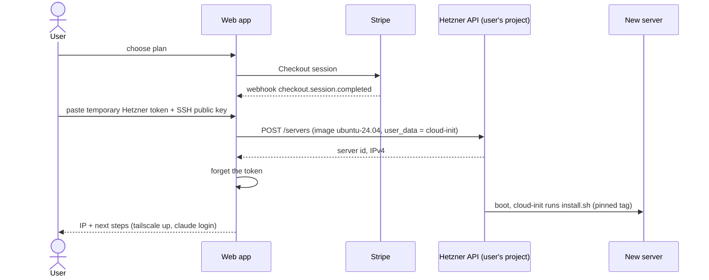

# Provisioning (Phase 2, design only)

Nothing here is implemented yet. This document fixes the contract between a future provisioning service and
`install.sh`, so Phase 1 code does not need to change when Phase 2 arrives.

## Principles

- **Zero custody.** The maintainer never hosts user servers and never stores user credentials.
- **The user's cloud account.** Servers are created in the user's own Hetzner project, billed to them.
- **The user's Claude account.** The user logs in to Claude Code on their server themselves.
- **Short-lived tokens.** A Hetzner API token is used for one provisioning run and then discarded (and the user is told to revoke it).

## Flow

## Contract with install.sh

The provisioning layer only renders cloud-init user data. `install.sh` reads:

| Input | How |
|---|---|
| Release | `git clone --branch vX.Y.Z` in `runcmd` (always a tag, never `main`) |
| Configuration | `/etc/claude-cloud-browser/install.env` written by `write_files` (`CB_*` variables, see `.env.example`) |
| SSH access | `CB_SSH_PUBKEY` and/or the key injected by Hetzner + `CB_COPY_ROOT_KEYS=yes` |

`install.sh` must keep these guarantees for provisioning to rely on them:

1. Non-interactive and idempotent; exit code 0 means every step succeeded.
2. Never requires or stores a credential.
3. Never removes firewall rules it did not create.

Template: [../cloud-init/user-data.yaml](../cloud-init/user-data.yaml).

## Open questions

- Tailscale enrollment without manual `tailscale up` (user-provided auth key, single use, ephemeral?).
- Upgrades of existing boxes: `cb update` pulling a newer tag.
- Supporting other providers through the same user-data contract.
